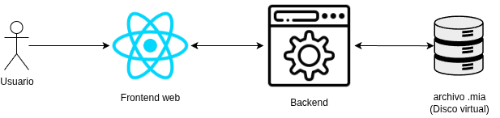
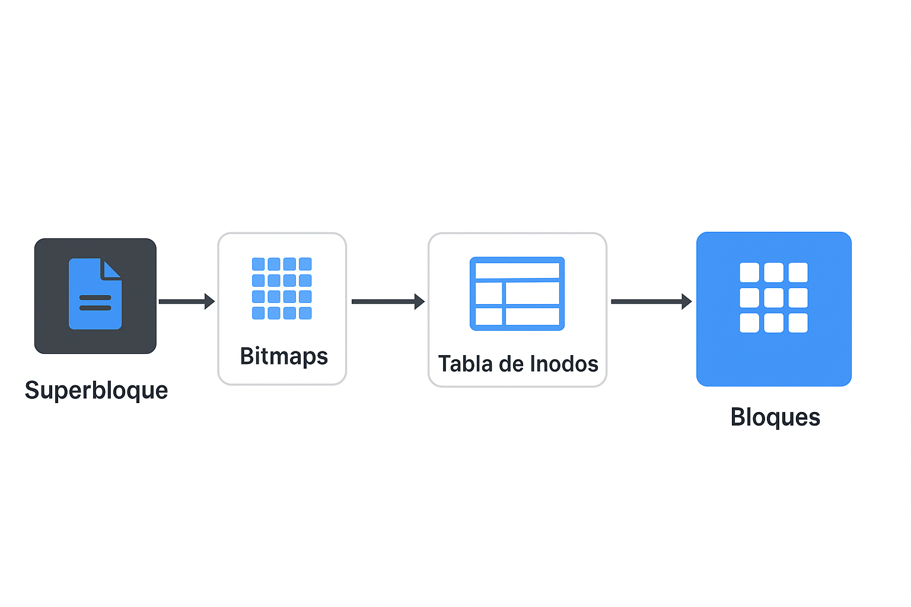
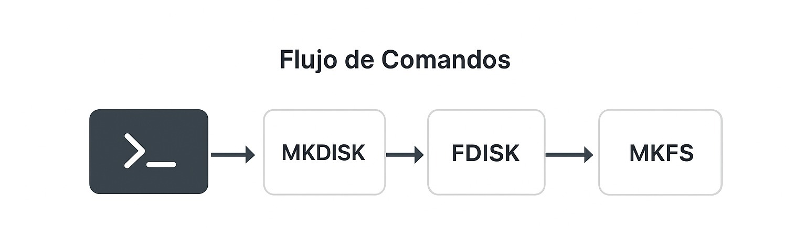

UNIVERSIDAD DE SAN CARLOS DE GUATEMALA

FACULTAD DE INGENIERÍA

MANEJO E IMPLEMENTACIÓN DE ARCHIVOS

CATEDRÁTICO: ING. WILLIAM ESTUARDO ESCOBAR ARGUETA

TUTOR ACADÉMICO: DANIEL EDUARDO MELLADO AYALA

======================================================================================

    <h1 style="color: black; text-decoration: underline; text-decoration-color: white;"> MANUAL TÉCNICO ExtreamFS

=======================================================================================

OTTONIEL FABRICIO VÁSQUEZ PINEDA
 
CARNÉ: 202307820
 
SECCIÓN B

GUATEMALA 7 DE SEPTIEMBRE DEL 2025

# Mánual Técnico - ExtreamFS

## 1. Introducción

ExtreamFS es una aplicación web multiplataforma diseñada por un sistema integral de gestión diseñado para la simulación y administración de un sistema de archivos basado en EXT2.
La solución integra un backend implementado en Go que gestiona la lógica del sistema de archivos (discos virtuales .mia, particiones, MBR/EBR, siperbloque, inodos, bitmaps y bloques) y un frontend interactivo (React) que permite a los usuarios ejecutar comandos, cargar scripts .smia, visualizar salidas y generar reportes con la herramienta Graphviz. El propósito de la herramienta es ofrecer un entorno seguro y reproducible para experimentar con estructuras de disco, particiones y operaciones de sistema de archivos sin necesidad de hardware físico real.

---

## 2. Objetivos del Proyecto

### Objetivo General
Desarrollar y documentar una aplicación web que simule un sistema de archivos EXT2, permitiendo la creación y administración de discos virtuales, particiones, inodos, bloques, usuarios y permisos, mediante una interfaz gráfica y APIs REST, para facilitar el aprendizaje y la experimentación práctica con estructuras de almacenamiento.

### Objetivos expecíficos

- **1. Implementar la estructura y gestión del disco virtual:**
    - construir las estructuras binarias necesarias (MBR, EBR, Superbloque, tablas de inodos, bitmaps y bloques) dentro de archivos .mia, soportando creación, eliminación, particionado y montaje de particiones, y garantizando consistencia en las actualizaciones de metadatos.

- **2. Proveer una interfaz de usuario y API robustas:**
    - Diseñar un frontend intuitivo para introducir comandos y ver resultados, y un backend en Go que exponga APIs REST para ejecutar comandos, procesar scvripts .smia y devolver salidas y reportes; todo con validaciones, manejo de errores y control de sesiones/usuarios.

- **3. Generar reportes y herramientas didácticas:**
    - Implementar generación de reportes (MBR, disco, inodos, bloques, bitmaps, ábol, superbolque, file, ls) mediante Graphviz y formatos legibles (JPEG/PDF/TXT), para visualizar el estado interno del sistema y facilitar el análisis educativo de las operaciones realizadas.

---

## 3. Requerimientos del sistema

Requerimientos recomendados

**Hardware:**
* CPU: 4 núcleos o más
* RAM: 8 GB.
* Disco: 20 GB de espacio disponible (para código, dependencias y varios archivos .mia)
* Conexión a Internet: opcional para instalar dependencias y actualizaciones.

**Software:**
* Sistema operativo: Linux (recomendado).
* Go (Golang): versión compatible (recomendado > 1.20)
* Node.js (recomendado > 16 LTS) y npm > 8 
* React App 18+
* Graphviz: instalación disponible para generar imagenes DOT, JPG/PDF.
* Herramientas opcionales: VS Code u otro IDE, herramientas de test.

---

## 4. Requisitos funcionales y permisos
* El usuario que ejecute el backend debe tener permisos de lectura/escritura en las rutas donde se crean los discos .mia y los reportes.
* El backend debe ser capaz de abrir archivos en modo lectura/escritura binaria sin truncar (salvo que el comando lo solicite).
* El sistema deberá garantizar que la creación de discos reserva físicamente el espacio (escribir ceros) y que no se modifique el tamaño del .mia después de su creación, salvo operaciones controladas por los comandos definidos.

---

## **5. Requisitos no funcionales**
* **Portabilidad:** La aplicación debe ejecutarse preferiblemente en Linux.
* **Seguridad:** Las contraseñas en users.txt se almacenan en el disco de la partición simulada; en esta primera versión pueden ser texto plano.
* **Rendimiento:**  Las operaciones de creación y formateo deben ser razonablemente eficientes.
* **Mantenibilidad:** El backend en Go debe seguir separación de responsabilidades y contar con test unitarios básicos.

---

## **6. Arquitectura del Sistema**

### **6.1 Componentes Principales**
* **Frontend React:**
    - Proporciona la interfaz gráfica para que el usuario ejecute comandos y visualice resultados.
    - Elementos principales:
        - Área de Entrada de Comandos
        - Área de Salida
        - Botones: Ejecutar y Cargar Script.
* **Backend (Golang)**:
    * Implementa la lógica de negocio para simualr el sistema de archivos EXT2
    * Expone APIs REST para que el frontend interactúe con las operaciones.
    * Maneja estructuras de bajo nivel: discos (.mia), particiones, inodos, bloques, bitmaps.

### **6.2 Diagrama de Arquitectura**

 

---

## **7. Estructuras de Datos del Sistema EXT2**

### **7.1 Disco y Particiones**
* **MBR (Master Boot Record):**
    - Guarda tamño del disco, fecha de creación, signature, tipo de ajuste y lista de 4 particiones.
- **Particiones**;
    - Primeria (P)
    - Extendida (E) con lista enlazada de EBRs.
* **EBR (Extended Boot Record):**
    - Administra particiones lógicas dentro de una extendida

### **7.2 Sistema EXT2 Interno**
* **Superbloque (superblock):**
    - Contiene metadatos del sistema (número de inodos, bloques, bitmaps, posiciones, magic number 0xEF53).
* **Inodos:**
    - Contienen UID, GID, permisos, timestamps, apuntadores directos e indirectos.
* **Bloques:**
    - Bloque Carpeta
    - Bloque Archivo
    - Bloque Apuntador
* **Bitmaps:**
    - Bitmap de inodos y bitmap de bloques (0=libre, 1=ocupado).

### Diagrama de EXT2

 

---

## **8. Comandos Implementados**

### **8.1 Administración de Discos**

#### **MKDISK**
* **Función:** Crea un disco virtual (.mia) inicializado con ceros.
* **Parámetros:**
    - *-size:* Tamaño (obligatorio).
    - *-unit:* (Opcional) K o M (por defecto M).
    - *-fit:* (Opcional) BF | FF | WF (por defecto FF).
    - *-path:* Ruta donde se creará el archivo (obligatorio).

- Ejemplo:

~~~Go
mkdisk -size=3000 -unit=k -path="/home/users/discos/Disco1.mia"
~~~

#### **RMDISK**
* **Función:** Elimina un disco.
* **Parámetros:**
    - -path: Ruta del archivo (obligatorio).
* **Ejemplo:**

~~~Go
rmdisk -path="/home/users/discos/Disco.mia"
~~~

#### **FDISK**
* **Función:** Crea, elimina o modifica particiones.
* **Parámetros:** -size, -unit, -path, -type, -fit, -name.
* **Ejemplo:**

~~~Go
fdisk -size=300 -unit=k -path=/home/users/disco/Disco1.mia -name=part -type=p
~~~

### **8.2 Administración de Montajes**

#### **MOUNT**
* Monta una partición primaria o lógica.
* Genera un ID único: <CarnetUltimosDosDigitos><Número><Letra>.

~~~Go
mount -path=/home/user/discos/Disco1.mia -name=part1
~~~

#### **MOUNTED**
* Muestra todas las particioones montadas en memoria.
* **Ejemplo:**

~~~Go
mounted
~~~

### **8.3 Administración del Sistema de Archivos**
* **MKFS:**
* Formatea la partición EXT2.
* **Ejemplo:**

~~~Go
mkfs -id=201A
~~~

### **8.4 Administración de Uusarios y Grupos**
* **Login:**
* Se Loguea un usario inicia sesión en el sistema
* **Ejemplo:**

~~~Go
login -user=root -pass=123 -id=062A​
~~~

* **LOGOUT:**
* Va a cerrar de un usuario que haya iniciado sesión.
* **Ejemplo:**

~~~Go
logout
~~~

* **MKGRP:**
* Creará nuevos grupos en la partición y se guardan en users.txt y solo lo puedo utlizar root
* **Ejemplo:**

~~~Go
mkgrp -name=usuarios
~~~

* **RMGRP:**
* Elimina los grupos de la partición y solo lo puede ejecutar el root.
* **Ejemplo:**

~~~Go
rmgrp -name=usuarios
~~~

* **MKUSR:**
* Crea usuarios nuevos en la partición y en un grupo que existay se guardan en users.txt y solo lo puede utilizar el root
* Parametros: -user -pass -grp
* **Ejemplo:**

~~~Go
mkusr -user="usuario1" -pass=password -grp=root
~~~

* **RMUSR:**
* Elimina un usuario de un grupo dentro de la partición y este comando solo lo puede utilizar el root
* **Ejemplo:**

~~~Go
rmusr -user=usuario11​
~~~

* **CHGRP:**
* Cambia de grupo al usuario que se vaya a escoger dentro de una partición, este comando solo lo puede usar el root.
* **Ejemplo:**

~~~Go
chgrp -user=user1 -grp=grupo2
~~~

### **8.5 Manejo de Archivos**
* **MKFILE:**
* Creará un archivo, el propietario será el usuario que actualmente ha iniciado sesión. Tendrá los permisos 664
* Parámetros: -path(obligatorio) -r -size -cont
* **Ejemplo:**

~~~Go
mkfile -size=15 -path=/home/user/docs/a.txt -r
mkfile -path=/home/user/docs/b.txt -r -cont=/home/Documents/b.txt
~~~

* **MKDIR:**
* Este comando crea Carpetas, el propietario será el usuario que actualmente ha iniciado sesión. Tendrá los permisos 664
* Parámetros: -path(obligatorio) -p

### **8.6 Reportes**
* **REP:**
* Genera reportes usando Graphviz
    * MBR, disk, inode, block, bm_inode, bm_block, tree, sb, file, ls.
    - Parámetro para file y ls: -path_file_ls
* **Ejemplo:**

~~~Go
rep -id=A118 -path=/home/user/reports/reporte1.jpg -name=mbr
rep -id=A118 -path=/home/user/reports/report9.txt -path_file_ls=/home/a.txt -name=file
~~~

---

## **9. Flujo de Ejecución**

1. Crear disco con MKDISK.

2. Crear partición con FDISK.

3. Montar partición con MOUNT.

4. Formatear con MKFS.

5. Iniciar sesión con LOGIN.

5. Crear usuarios y grupos (MKUSR, MKGRP).

6. Crear carpetas y archivos (MKDIR, MKFILE).

7. Generar reportes (REP).

8. Salir de sesión con LOGOUT.

 

## **10. Conclusión**

El proyecto ExtreamFS ofrece una simulación completa y didática del funcionamiento interno de unsistema de archivos EXT2, integrando un frontend en React con un backend en lenguaje Go que gestiona discos virtuales .mia, particiones, superbloque, bitmaps, tabla de inodos y bloques. Esta herramienta facilita el aprendizaje pŕactico: permite crear discos, particionar, montar, formatear y operar sobre archivos y usuarios, además de generar reportes visuales (en Graphviz) que hacen transparentes las estructuras internas.

