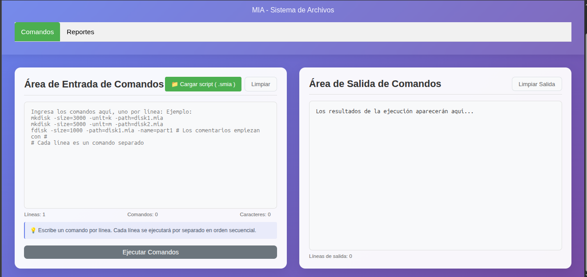
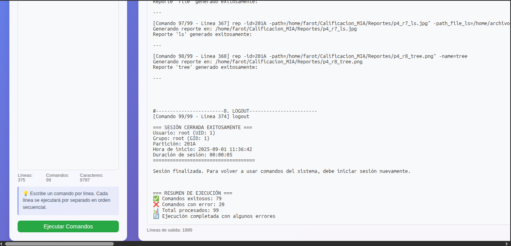
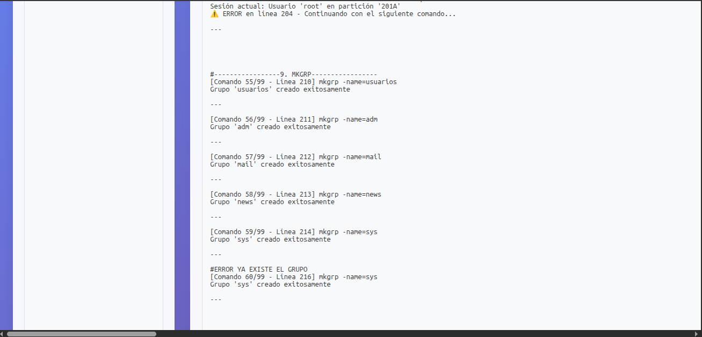
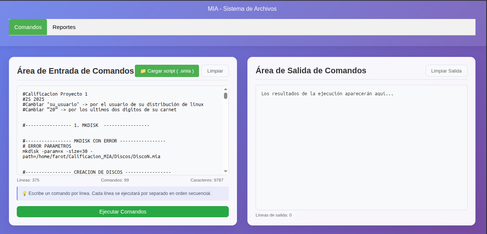
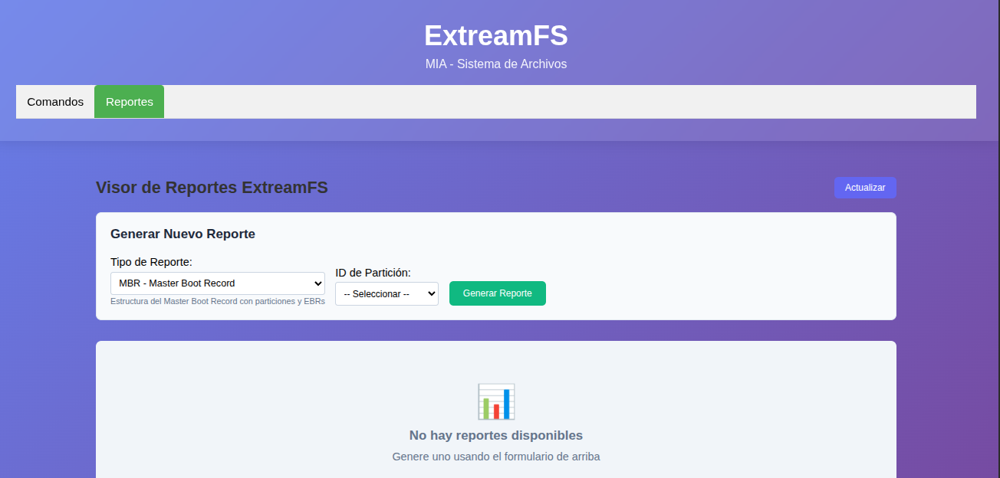
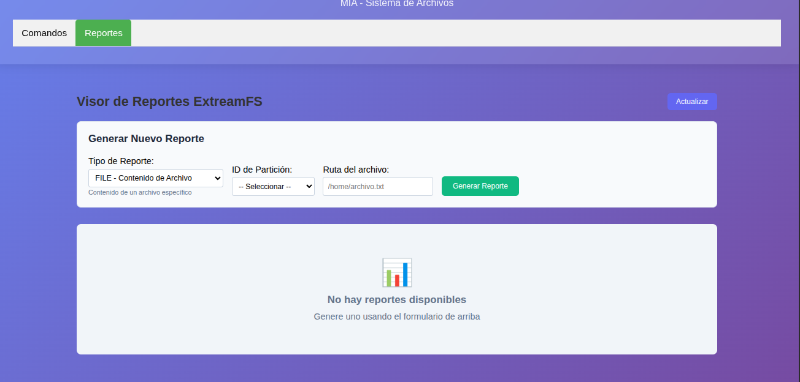
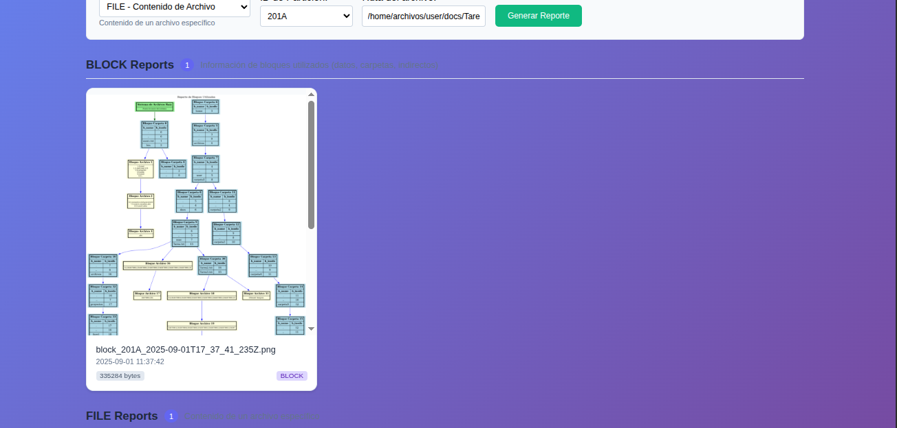
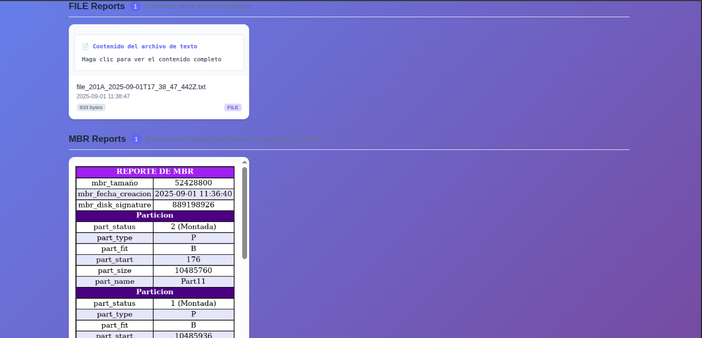
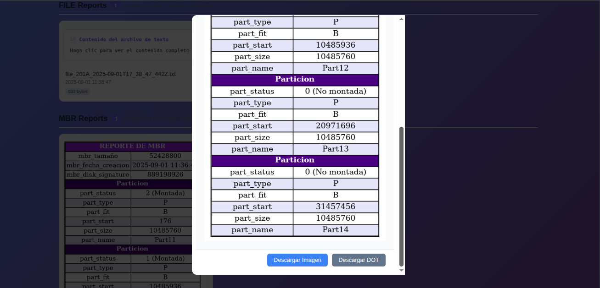
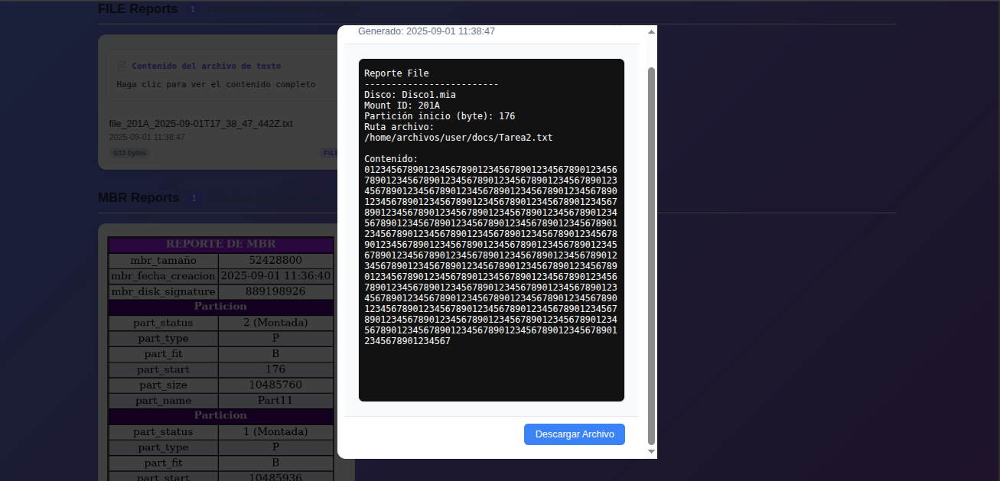

UNIVERSIDAD DE SAN CARLOS DE GUATEMALA

FACULTAD DE INGENIERÍA

MANEJO E IMPLEMENTACIÓN DE ARCHIVOS

CATEDRÁTICO: ING. WILLIAM ESTUARDO ESCOBAR ARGUETA

TUTOR ACADÉMICO: DANIEL EDUARDO MELLADO AYALA

======================================================================================

    <h1 style="color: black; text-decoration: underline; text-decoration-color: white;"> MANUAL USUARIO ExtreamFS

=======================================================================================

OTTONIEL FABRICIO VÁSQUEZ PINEDA
 
CARNÉ: 202307820
 
SECCIÓN B

GUATEMALA 7 DE SEPTIEMBRE DEL 2025

---

## **1. Introducción**

Este manual explica cómo utilizar la aplicación del proyecto: creación y administración de discos virtuales (.mia), particiones, sistema de archivos tipo EXT2 simulado, gestión de usuarios y generación de reportes gráficos. Está pensado para estudiantes y evaluadores que usan la interfaz web (frontend) y la API backend del proyecto.

## **2. Requisitos mínimos del Sistema**

### **Hardware**

* Procesador: Intel/AMD de 64 bits.
* Memoría RAM: 4GB mínimo.
* Espacio en disco: 500 MB para pruebas

### **Software**

* Sistema Operativo: Linux (Ubuntu recomendado).
* GoLang: Versión 1.20 o superior
* Node.Js: Versión 18 o superior para el frontend.
* Graphviz: instalado para la generación de reportes gráficos.
* Instalar Graphviz: sudo apt install graphviz.
* Navegador Web: Chrome, Firefox o Edge.

## **3. Conceptos básicos**
- .mia: archivo que simula un disco. Contiene MBR/EBR, particiones y la estructura del sistema de archivos.

- MBR (Master Boot Record): contiene la tabla de particiones principal.

- EBR: estructura usada para particiones extendidas y lógicas.

- EXT2 (simulado): sistema de archivos con superbloque, bitmaps (inodos y bloques), tabla de inodos y bloques de datos.

- Mount: operación que registra en memoria la información de una partición montada y la asocia con un id.

## **4. Instalación / Ejecución**
### **4.1. Iniciar frontend**

1. Abrir la terminal en el frontend e instalar dependencias del npm.

2. En el área de comandos: Escribre el comando **npm start** para iniciar el frontend en el puerto http://localhost:3000

### **4.2. Iniciar backend**

1. Abrir la terminal donde esta el backend, instalar dependencias con go mod tidy

2. En el área de comandos: Escribe el comando **go run . server** para ejecutar el backend en el puerto de http://localhost:8080

Nota: el proyecto no crea particiones fuera del archivo .mia. Todo se gestiona dentro de ese archivo.

## **5. Interfaz de usuario**

La interfaz cuenta con:

* Área de entrada: campo de texto para comandos o carga de archivo .smia.

* Botón Ejecutar: envía los comandos al backend.

* Área de salida: muestra mensajes de error, advertencia o confirmación, y enlaces a reportes generados.

* Cargar Scripts: carga un archivo con extensión .smia en la cual este puede contener comandos ya hechos desde tu computadora.

* boton de limpiar: este puede limpiar la entrada de comandos o la salida de comandos.

* Boton de reportes: Este le manda a una pestaña donde puede mostrarle los reportes.

 

* Al ver la salida de comandos puede quedar algo así de varios comandos, pero al final te va mostrar un resumen de lo que paso en el programa, cuantos comandos erroneos, cuantos comandos exitosos y total de comandos, también con descripciones de cada comando y que número de comando va.

 

 

 

### **Pestaña Reportes**

* Tiene un combo box para ver que tipo de reporte hay 

* El ID de la partición de la cual se creo el reporte

* Cuando pones el tipo de reporte con ls o file, se agrega un nuevo combobox en la cual ahí se tiene que colocar el -path_file_ls

 

 

* Al generar reportes se mostrarán algo así

 

 

* También podes seleccionar el reporte apachandolo encima con el cursos para verlo mejor y tendrá 2 opciones descargar la imagen o el dot de la imagen o también si es un archivo txt podrás descargar el archivo txt

 

 

## **6. Comandos disponibles (sintaxis y ejemplos)**

A continuación se listan los comandos principales, su propósito, parámetros obligatorios y ejemplos de uso.

### **6.1. Gestión de discos**

* MKDISK — crea un archivo .mia (MBR inicial).

    - Sintaxis: mkdisk -size=<n> -path="/ruta/archivo.mia" -unit=[k|m]

    - Ejemplo: mkdisk -size=10 -path="/home/user/disk1.mia" -unit=m

    - Resultado: archivo creado y MBR escrito.

* RMDISK — elimina un archivo .mia.

    - Sintaxis: rmdisk -path="/ruta/archivo.mia"

    - Ejemplo: rmdisk -path="/home/user/disk1.mia"

### **6.2. Particiones**

* FDISK — crea, borra o modifica particiones.

    - Parámetros comunes: -size, -path, -name, -type=[p|e|l], -fit=[bf|ff|wf], -delete=[fast|full]

    - Ejemplo crear primaria: fdisk -size=5 -path="/home/user/disk1.mia" -name=part1 -type=p -fit=ff

    - Ejemplo eliminar: fdisk -delete=full -path="/home/user/disk1.mia" -name=part1

### **6.3. MOUNT / MOUNTED**

* MOUNT — monta una partición y devuelve un id.

    - Sintaxis: mount -path="/home/user/disk1.mia" -name=part1

    - Ejemplo: mount -path="/home/user/disk1.mia" -name=part1 → devuelve vd1 (o similar).

* MOUNTED — lista particiones montadas.

    - Sintaxis: mounted

Cuando montás una partición, la aplicación crea una tabla de montajes en RAM; cada entrada recibe un id único para usar en operaciones posteriores.

### **6.4. Sistema de archivos EXT2**

* MKFS — formatea la partición montada como EXT2.

    - Sintaxis: mkfs -id=<idMontaje> -type=full -fs=ext2

    - Ejemplo: mkfs -id=vd1 -type=full -fs=ext2

    - Resultado: escribe superbloque, bitmaps (inodo y bloque), tabla de inodos y bloques. Crea users.txt en la raíz.

* MKDIR — crea directorios.

    - Sintaxis: mkdir -path="/ruta/directorio" -p=[true|false] -id=<idMontaje>

    - Ejemplo: mkdir -path="/home/docs" -p=true -id=vd1

* MKFILE — crea o escribe archivos.

    - Sintaxis: mkfile -path="/home/docs/nota.txt" -size=512 -id=vd1 -cont="contenido..."

    - Ejemplo: mkfile -path="/home/docs/nota.txt" -size=1 -id=vd1 -cont="Hola"

* CAT — muestra contenido de un archivo.

    - Sintaxis: cat -path="/home/docs/nota.txt" -id=vd1

### **6.5. Usuarios y grupos**

* LOGIN — inicia sesión de usuario (necesario para muchas operaciones).

    - Sintaxis: login -user=usuario -pass=contraseña -id=vd1

* LOGOUT — cierra la sesión.

    - Sintaxis: logout

* MKGRP / RMGRP — gestión de grupos

    - Ejemplo: mkgrp -name=usuarios

    - Eliminar grupo: rmgrp -name=usuarios

* MKUSR / RMUSR - gestión de usuarios

    - Ejemplo: mkusr -user="usuario1" -pass=password -grp=root

    - Eliminar Usuario: rmusr -user=user1

* CHGRP - cambiar usuario de grupo

    - Ejemplo: chgrp -user=user1 -grp=grupo2

### **6.6. REP (reportes)**

* REP — genera reportes a partir del estado de disco/FS.

    - Sintaxis: rep -name=[mbr|disk|inode|block|tree|bm_inode|bm_block|sb] -id=201A -path="/ruta/salida/rep.png"

    - Ejemplo: rep -name=tree -id=vd1 -path="/home/user/reports/tree.png"

* Reporte para file:

    - Sintaxis: rep -name=file -id=201A -path=/home/user/reporte/texto.txt -path_file_ls=/home/a.txt

* Report para ls:

    - Sintaxis: rep -name=ls -id=201A -path=/home/user/reporte/report10.jpg -path_file_ls=/home

Notas: los reportes suelen generarse como archivos Graphviz; si Graphviz está instalado se exportan a PNG/SVG o también exceptuando de un reporte, se generara en tipo txt. También va a depender de extensión le vaya a poner a su reportes, me refiero si es tipo .jpg, .png, .pdf, etc y entre otros.

## **7. Ejemplos paso a paso**
### **7.1. Crear disco, partición, montar y formatear**

1. mkdisk -size=20 -path="/home/user/diskA.mia" -unit=m

2. fdisk -size=10 -path="/home/user/diskA.mia" -name=partA -type=p -fit=ff

3. mount -path="/home/user/diskA.mia" -name=partA → devuelve 201A

4. mkfs -id=201A -type=full -fs=ext2

5. login -user=root -pass=123 -id=201A

6. mkdir -path="/docs" -p

7. mkfile -path="/docs/nota.txt" -cont=/home/farot/Descargas/nes.txt

8. rep -name=tree -id=201A -path="/home/user/reports/tree.png"

9. logout

### **8. Manejo de errores comunes**

* Error: No sesión iniciada — muchos comandos requieren login; ejecutar login primero.

* Error: Partición no encontrada — verificar que la partición esté montada (mounted) y que el id sea correcto.

* Error: Espacio insuficiente — al crear archivos/estructuras, si no hay bloques libres, la operación fallará.

* Error: Permisos denegados — operaciones de administración (crear usuarios/grupos, formateo) requieren usuario root o permisos especiales.

### **9. Buenas prácticas**

- Montar particiones con nombres descriptivos para facilitar su identificación.

- Usar rep con frecuencia para auditar el estado del disco (mbr, bitmap, tree).

- Antes de formatear una partición, asegurarse de tener respaldos (si corresponde).

### **10. Tabla de comandos**

|**No-** | **Comando** | **Descripción**                                                                 | **Sintaxis**                                                                                     | **Ejemplo**                                                                                     |
|-------|-------------|---------------------------------------------------------------------------------|--------------------------------------------------------------------------------------------------|-------------------------------------------------------------------------------------------------|
| **1** | **MKDISK**  | Crea un archivo `.mia` (MBR inicial).                                           | `mkdisk -size=<n> -path="/ruta/archivo.mia" -unit=[k o m]`                                         | `mkdisk -size=10 -path="/home/user/disk1.mia" -unit=m`                                         |
| **2** | **RMDISK**  | Elimina un archivo `.mia`.                                                     | `rmdisk -path="/ruta/archivo.mia"`                                                              | `rmdisk -path="/home/user/disk1.mia"`                                                          |
| **3** | **FDISK**   | Crea, borra o modifica particiones.                                            | `fdisk -size=<n> -path="/ruta/archivo.mia" -name=<nombre> -type=[p "o" e "o" l] -fit=[bf "o" ff "o" wf]`         | `fdisk -size=5 -path="/home/user/disk1.mia" -name=part1 -type=p -fit=ff`                       |
| **4** | **MOUNT**   | Monta una partición y devuelve un ID.                                          | `mount -path="/ruta/archivo.mia" -name=<nombre>`                                                | `mount -path="/home/user/disk1.mia" -name=part1`                                               |
| **5** | **MOUNTED** | Lista las particiones montadas.                                                | `mounted`                                                                                       | `mounted`                                                                                      |
| **6** | **MKFS**    | Formatea la partición montada como EXT2.                                       | `mkfs -id=<idMontaje> -type=full -fs=ext2`                                                      | `mkfs -id=vd1 -type=full -fs=ext2`                                                             |
| **7** | **MKDIR**   | Crea directorios.                                                              | `mkdir -path="/ruta/directorio" -p=[true "o" false] -id=<idMontaje>`                                | `mkdir -path="/home/docs" -p=true -id=vd1`                                                    |
| **8** | **MKFILE**  | Crea o escribe archivos.                                                       | `mkfile -path="/ruta/archivo" -size=<n> -id=<idMontaje> -cont="contenido..."`                   | `mkfile -path="/home/docs/nota.txt" -size=1 -id=vd1 -cont="Hola"`                              |
| **9** | **CAT**     | Muestra el contenido de un archivo.                                            | `cat -path="/ruta/archivo" -id=<idMontaje>`                                                     | `cat -path="/home/docs/nota.txt" -id=vd1`                                                     |
| **10** | **LOGIN**   | Inicia sesión de usuario.                                                      | `login -user=<usuario> -pass=<contraseña> -id=<idMontaje>`                                      | `login -user=root -pass=123 -id=vd1`                                                           |
| **11** | **LOGOUT**  | Cierra la sesión.                                                              | `logout`                                                                                        | `logout`                                                                                       |
| **12** | **MKGRP**   | Crea un grupo de usuarios.                                                     | `mkgrp -name=<nombre>`                                                                          | `mkgrp -name=usuarios`                                                                         |
| **13** | **RMGRP**   | Elimina un grupo de usuarios.                                                  | `rmgrp -name=<nombre>`                                                                          | `rmgrp -name=usuarios`                                                                         |
| **14** | **MKUSR**   | Crea un usuario.                                                               | `mkusr -user=<usuario> -pass=<contraseña> -grp=<grupo>`                                         | `mkusr -user="usuario1" -pass=password -grp=root`                                              |
| **15** | **RMUSR**   | Elimina un usuario.                                                            | `rmusr -user=<usuario>`                                                                         | `rmusr -user=user1`                                                                            |
| **16** | **CHGRP**   | Cambia un usuario de grupo.                                                    | `chgrp -user=<usuario> -grp=<grupo>`                                                            | `chgrp -user=user1 -grp=grupo2`                                                                |
| **17** | **REP**     | Genera reportes a partir del estado del disco o sistema de archivos.           | `rep -name=<tipo> -id=<idMontaje> -path="/ruta/salida/archivo"`                                 | `rep -name=tree -id=vd1 -path="/home/user/reports/tree.png"`                                   |
| **18** | **REP FILE**| Genera un reporte de archivo.                                                  | `rep -name=file -id=<idMontaje> -path="/ruta/salida/archivo" -path_file_ls="/ruta/archivo.txt"` | `rep -name=file -id=201A -path=/home/user/reporte/texto.txt -path_file_ls=/home/a.txt`         |
| **19** | **REP LS**  | Genera un reporte de listado de directorio.                                    | `rep -name=ls -id=<idMontaje> -path="/ruta/salida/archivo" -path_file_ls="/ruta/directorio"`    | `rep -name=ls -id=201A -path=/home/user/reporte/report10.jpg -path_file_ls=/home`             |